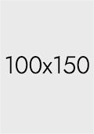
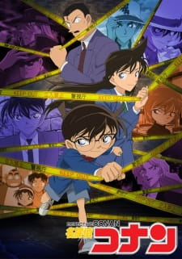
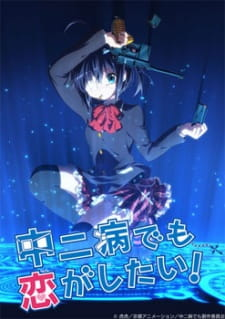
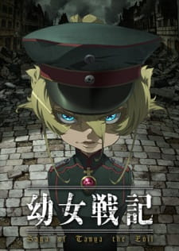
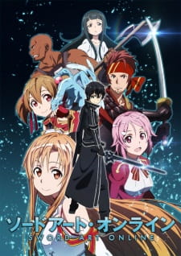
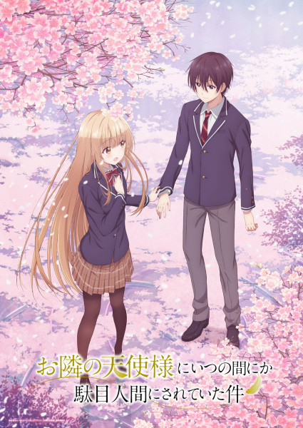

<div align="center">

<h1 style="color: #58a6ff; font-size: 1em; margin: 1.33em 0;">⚡🌸 Welcome to My GitHub 🌸⚡</h1>

  

## 🌸✨ [Avin1731](https://github.com/Avin1731) | [Xte1412](https://github.com/Xte-1412) ✨🌸
### ⚡🌸 [AcademyCity-RND](https://github.com/AcademyCity-RND) 🌸⚡ 
### ~ Electronics Engineering & Software Engineering ~
#### **Web Development - Frontend Developer**
*~ Anime Enthusiast • Hololive Fans • Gaming Enjoyer ~*

</div>

---

## 👋 About Me

I'm a **Frontend Developer** who loves tidy workflows, pixel-perfect UIs, and interactive animations. I code best when the world is asleep, often accompanied by Anisong or VTuber streams.

```javascript
const avin = {
    role: "Frontend Web Developer",
    workingOn: ["Clean Code", "Interactive UI", "Tidy Architecture"],
    learning: ["AI Engineering", "Cybersecurity"],
    hobbies: ["Mobile Legends", "Umamusume Pretty Derby", "Anime Marathon"],
    fandom_allegiance: {
        pairing_1: "AmeSame 💛💙",
        pairing_2: "Grindstone 🔨💎",
        guilds: ["Pemaloe", "Pebble"]
    },
    philosophy: "Codes and works best when the world is asleep 🌙"
};

```

---

## 🛠️ Technology Arsenal

<table>
<tr>
<td valign="top" width="33%">

### 🎨 Frontend & UI

* **Core:** TypeScript, JavaScript, React
* **Framework:** **Next.js (App Router)**
* **Styling:** TailwindCSS, Shadcn UI, Bootstrap
* **State:** TanStack Query
* **Design:** Figma

</td>
<td valign="top" width="33%">

### ⚙️ Backend & Data

* **Frameworks:** Laravel, Python
* **Database:** PostgreSQL (Neon), MongoDB, MySQL
* **ORM:** **Drizzle ORM**
* **API:** REST API Integration

</td>
<td valign="top" width="33%">

### 🚀 Tools & DevOps

* **Version Control:** Git, GitHub
* **Deployment:** Vercel
* **Editor:** VS Code
* **Environment:** Windows / Linux

</td>
</tr>
</table>

---

## 🏗️ Architecture & Workflow

> "I believe in structured, maintainable codebases."

Here is how I typically structure my **Next.js** applications to ensure scalability and cleanliness:

```text
src/
├── app/                  # Pages & Routes (App Router)
├── actions/              # Server Actions (Backend Logic)
├── components/
│   ├── ui/               # Shadcn atomic components
│   ├── layout/           # Navbar, Footer, Sidebar
│   ├── dashboard/        # Admin specific (Forms, Tables)
│   ├── emails/           # React Email templates
│   ├── home/             # Landing page sections
│   └── animation/        # Reusable motion wrappers
├── lib/                  # Utilities, DB config & Auth setup
└── db/                   # Drizzle schema & migrations

```

---

## 🎯 My Expertise

```python
expertise = {
    "frontend": ["Pixel-perfect UI", "Responsive Design", "Interactive Animations"],
    "workflow": ["Tidy File Structure", "Component Modularity"],
    "vibes": ["Late Night Coding", "Aesthetic Focused"]
}

```

---

<div align="center">
  <h2 style="color: #c9d1d9; font-size: 1.5em;">🌸 Featured Projects 🌸</h2>

  <table style="width: 100%; max-width: 1000px; margin: 30px auto; border-collapse: collapse; background-color: #0d1117; border: 2px solid #0ff; border-radius: 6px;">
    <thead>
      <tr>
        <th style="background-color: #161b22; color: #58a6ff; padding: 16px; border-bottom: 2px solid #0ff;" width="150">Cover</th>
        <th style="background-color: #161b22; color: #58a6ff; padding: 16px; border-bottom: 2px solid #0ff;" width="400">Project Details</th>
        <th style="background-color: #161b22; color: #58a6ff; padding: 16px; border-bottom: 2px solid #0ff;" width="150">Status</th>
      </tr>
    </thead>
    <tbody>
      <tr style="background-color: #0d1117;">
        <td style="padding: 10px; border-bottom: 1px solid #30363d; text-align: center;">
          
        </td>
        <td style="padding: 20px; border-bottom: 1px solid #30363d; text-align: center;">
          <div style="font-size: 1.3em; font-weight: 600; margin-bottom: 8px; color: #3fb950;">Coming Soon..</div>
          <div style="font-size: 0.95em; margin-bottom: 12px; color: rgba(63, 185, 80, 0.8);">Next.js Project with Shadcn UI</div>
          <div>
            
            
            
          </div>
        </td>
        <td style="padding: 20px; text-align: center; border-bottom: 1px solid #30363d;">
          
        </td>
      </tr>
      <tr style="background-color: #0d1117;">
        <td style="padding: 10px; border-bottom: 1px solid #30363d; text-align: center;">
          
        </td>
        <td style="padding: 20px; border-bottom: 1px solid #30363d; text-align: center;">
          <div style="font-size: 1.3em; font-weight: 600; margin-bottom: 8px; color: #d29922;">Coming Soon..</div>
          <div style="font-size: 0.95em; margin-bottom: 12px; color: rgba(210, 153, 34, 0.8);">Fullstack Laravel / Next.js App</div>
          <div>
            
            
          </div>
        </td>
        <td style="padding: 20px; text-align: center; border-bottom: 1px solid #30363d;">
          
        </td>
      </tr>
    </tbody>
  </table>

</div>

<div align="center">
  <h2 style="color: #c9d1d9; font-size: 1.5em;">🌸 My Favorite Anime 🌸</h2>
 
  <table style="border: none; margin: 20px auto;">
    <tr>
      <td align="center" width="130" style="padding: 10px;">
        <a href="[suspicious link removed]">

<sub style="color: #c9d1d9;">Detective Conan</sub></a>
      </td>
      <td align="center" width="130" style="padding: 10px;">
        <a href="https://myanimelist.net/anime/14741/Chuunibyou_demo_Koi_ga_Shitai">

<sub style="color: #c9d1d9;">Chuunibyou</sub></a>
      </td>
      <td align="center" width="130" style="padding: 10px;">
        <a href="https://myanimelist.net/anime/4654/Toaru_Majutsu_no_Index">

<sub style="color: #c9d1d9;">Toaru Series</sub></a>
      </td>
    </tr>
    <tr>
      <td align="center" width="130" style="padding: 10px;">
        <a href="https://myanimelist.net/anime/32615/Youjo_Senki">

<sub style="color: #c9d1d9;">Youjo Senki</sub></a>
      </td>
      <td align="center" width="130" style="padding: 10px;">
        <a href="https://myanimelist.net/anime/11757/Sword_Art_Online">

<sub style="color: #c9d1d9;">Sword Art Online</sub></a>
      </td>
      <td align="center" width="130" style="padding: 10px;">
        <a href="https://myanimelist.net/anime/50739/">

<sub style="color: #c9d1d9;">Otonari Tenshi</sub></a>
      </td>
    </tr>
  </table>
</div>

<div align="center">
<br />
  <h2 style="color: #c9d1d9; font-size: 1.5em;">⚡ Hololive Protocol Active ⚡</h2>
<br />
  <h3 style="margin: 5px 0;">💛 <span style="color: #e6cc00; font-weight: bold;">AMESAME 4EVER</span> 💙</h3>
  <h3 style="margin: 5px 0;">🔨 <span style="color: #b08dff; font-weight: bold;">GRINDSTONE SUPREMACY</span> 💎</h3>
</div>

<div align="center">
<br />
  <h2 style="color: #c9d1d9; font-size: 1.5em;">🔗 Connect With Me 🔗</h2>
<br />
  <p style="color: #8b949e;">Always interested in discussing <b>Frontend Development, UI/UX, or Anime!</b></p>
  <p>
    <a href="https://www.instagram.com/vinx177/"></a>
    &nbsp;
    <a href="https://discordapp.com/users/819799820549095464"></a>
    &nbsp;
    <a href="mailto:hnostenostogei@gmail.com"></a>
  </p>
</div>

<div align="center">
<br />
  <h2 style="color: #c9d1d9; font-size: 1.5em;">🔥 GitHub Stats & Activity 🔥</h2>
<br />

  
<br /><br />

  
<br /><br />

  
</div>

<div>
<br />
  <h2 style="color: #c9d1d9; font-size: 1.5em;">🌙⚡ Night Owl Dev Manifest ⚡🌙</h2>
<br />
  <i style="color: #8b949e;">"May your silent progress outshine the noise,<br />and may every late-night commit sharpen you sharper than yesterday."</i>
</div>
